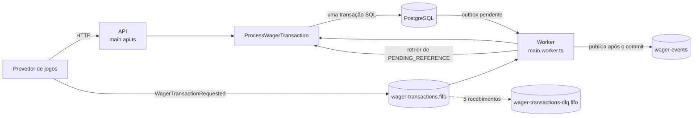
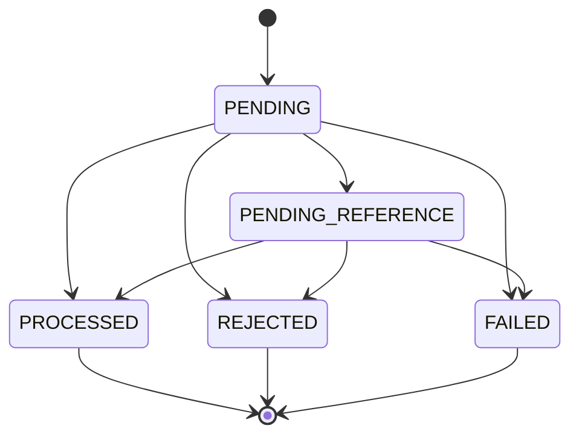
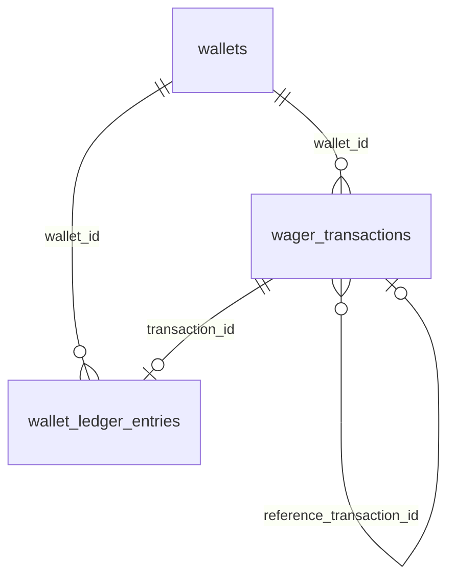
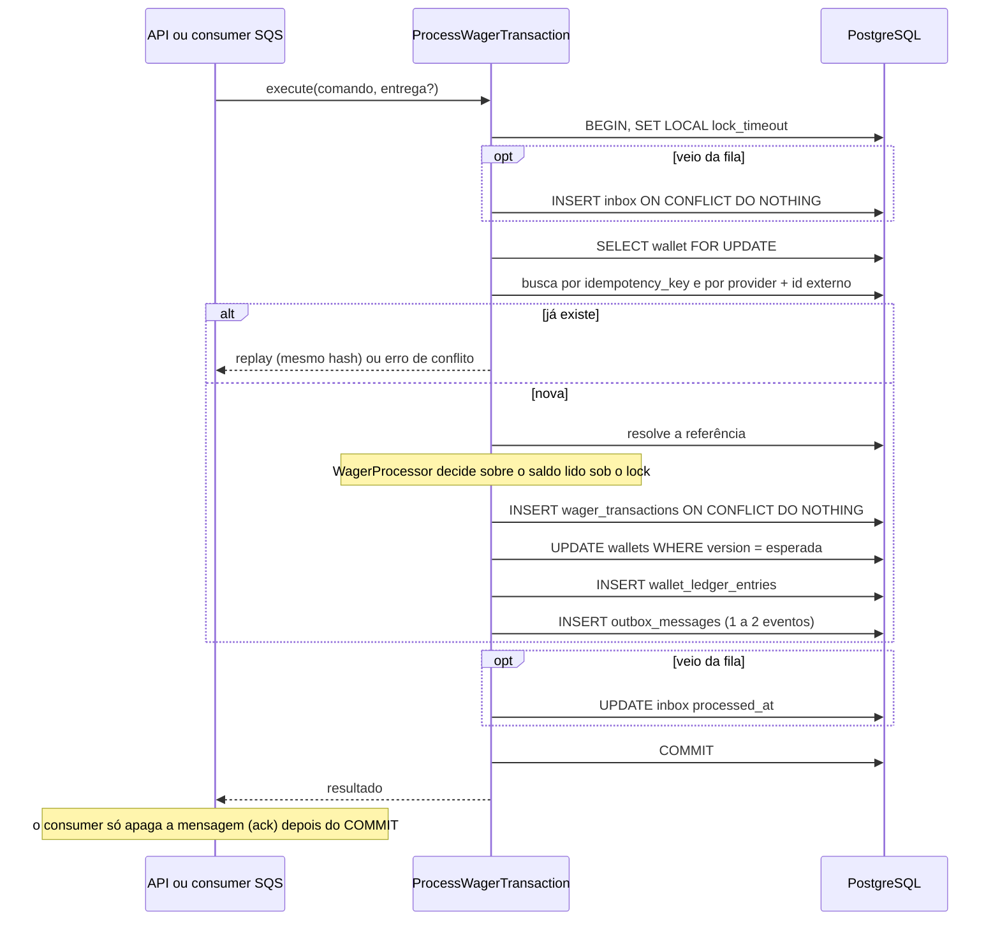

# Arquitetura

Este documento descreve a implementação real do Distributed Wagering Processor: como o código se organiza, como o banco garante as invariantes financeiras, como a concorrência e a idempotência são resolvidas e como o sistema se recupera de falhas. Para executar e usar o serviço, veja o [README.md](README.md).

## 1. Visão geral

Uma única imagem, dois pontos de entrada. Toda garantia vive no PostgreSQL e no SQS; os processos não guardam estado de que a correção dependa, então escalar é subir mais processos.



| Processo | Responsabilidades |
|---|---|
| **API** (`main.api.ts`) | HTTP: wallets, submissão e consulta de transações, ledger, reconciliação, health e métricas |
| **Worker** (`main.worker.ts`) | consumer da fila de entrada, publisher da outbox, retrier de `PENDING_REFERENCE`, health e métricas (porta interna) |

A API e o consumer chamam **o mesmo caso de uso**, `ProcessWagerTransaction`; o retrier chama o mesmo código por `resumePending`. Não há uma segunda implementação das regras.

## 2. Organização do código

```
src/
  main.api.ts · main.worker.ts · api.module.ts · worker.module.ts   raízes de composição
  persistence.module.ts                                              liga o unit of work aos repositórios
  api-exception.filter.ts                                            contrato único de erro HTTP
  app/
    wallet/       Wallet, WalletLedgerEntry, consultas, reconciliação
    wagering/     WagerTransaction, WagerProcessor, ProcessWagerTransaction, OpenWallet,
                  consumer SQS, retrier de pendências, controllers de submissão e consulta
    messaging/    InboxMessage, OutboxMessage, IntegrationEvent, publisher da outbox
    health/       liveness e readiness
  shared/         Money, erros base, configuração, contexto de requisição, observabilidade
  database/       migrations, MikroOrmUnitOfWork, tradução de erros do PostgreSQL
```

Cada módulo de funcionalidade segue as camadas `domain` (TypeScript puro), `application` (casos de uso e ports), `infrastructure` (MikroORM, SQS) e `presentation` (controllers). O módulo `wagering` depende de `wallet` e `messaging`; `wallet` não conhece `wagering`.

Essas fronteiras são **verificadas por teste** (`test/architecture`), que lê a árvore real de `src/`:

- o domínio não importa Nest, MikroORM, AWS, `application`, `infrastructure` ou `presentation`; `decimal.js` só aparece em `Money`;
- `application` e `presentation` não importam MikroORM nem AWS;
- as dependências entre módulos seguem uma lista declarada e não há ciclos entre arquivos nem entre módulos;
- só se entra na infraestrutura de outro módulo por `*.module.ts`.

A abertura de wallet (`OpenWallet`) mora em `wagering` porque cruza os dois agregados, e `wagering` já depende de `wallet` (decisão registrada em `docs/decisions/0001`).

### Domínio separado da persistência

As classes de domínio têm construtor privado e fábricas estáticas (`create`, `open`, `from`, `rehydrate`). `rehydrate` reconstrói estado já persistido sem revalidar transições. O MikroORM não hidrata classes com construtor privado, então cada tabela tem um `EntitySchema` de linha plana e um *mapper* converte linha em domínio (via `rehydrate`) e domínio em linha. A alternativa descartada, decorators do ORM nas classes de domínio, quebraria a independência do domínio e o construtor privado.

## 3. Domínio

| Elemento | Responsabilidade |
|---|---|
| `Money` (value object) | dinheiro imutável sobre `decimal.js`. Entrada só no formato `^(0\|[1-9]\d{0,17})\.\d{2}$` (string, exatamente 2 casas, sem sinal, sem notação científica, até 18 dígitos inteiros). Moedas diferentes lançam erro de domínio; somar além do limite lança `MoneyOverflowError`. Serializa sempre com 2 casas |
| `Wallet` (raiz do agregado) | `debit` e `credit` validam a moeda, alteram o saldo, incrementam a `version` e **devolvem o lançamento já calculado**: não existe mudança de saldo sem lançamento. `canDebit`/`canCredit` consultam sem alterar. `version` começa em 1 e só sobe quando o saldo muda |
| `WalletLedgerEntry` | lançamento imutável (sem métodos de transição); `create` valida a aritmética `before ± amount == after`, valor positivo e saldos não negativos |
| `WagerTransaction` | kind, status e dados da operação. Máquina de estados explícita; estados terminais não transicionam. Contém as regras que dependem só dela: referência exigida por kind, validação de player e moeda contra a wallet, `validateReference`, `ledgerDirectionFor`, `affectsBalance` |
| `WagerProcessor` (serviço de domínio) | apenas **sequencia** as regras já encapsuladas nas classes, sem estado nem IO: decide tudo antes de alterar a wallet |
| `InboxMessage` / `OutboxMessage` | deduplicação por mensagem recebida; evento a publicar, com backoff e reserva |
| `IntegrationEvent<T>` | envelope abstrato; subclasses `WagerTransactionProcessed`, `WagerTransactionRejected`, `WagerTransactionPendingReference` e `WalletBalanceChanged`, com `eventType` e `version` no tipo e dados em `MoneyProps` (string decimal) |
| `FailureCode` | taxonomia estável legível por máquina (ver README) |

### Estados de `WagerTransaction`



Tentar transicionar a partir de um estado terminal lança `InvalidTransactionStateError` (erro de programação, não caminho de negócio). Na persistência, a linha é inserida **já no estado final**: o domínio passa por `PENDING`, mas nenhuma linha `PENDING` é gravada, só `PENDING_REFERENCE` ou um estado terminal.

### Regras de negócio no código

- `BET`: débito; sem saldo vira `REJECTED` com `INSUFFICIENT_FUNDS`.
- `WIN`: crédito; referência opcional a `BET`; valor livre.
- `LOSS`: não chama `debit` nem `credit`; `PROCESSED` sem lançamento e sem alterar a versão.
- `REFUND`: crédito; referência obrigatória a `BET`; valor igual.
- `ROLLBACK`: aplica o inverso da referência (`BET` credita; `WIN` e `REFUND` debitam); referência a `BET`, `WIN` ou `REFUND`; valor igual. Se o débito deixaria o saldo negativo, `REVERSAL_INSUFFICIENT_FUNDS`, código distinto do de uma aposta sem saldo.
- A referência é resolvida por `(providerId, referenceExternalTransactionId)` e precisa coincidir em provider, player, wallet, moeda e rodada (`REFERENCE_MISMATCH`); referência `REJECTED` ou `FAILED` dá `REFERENCE_NOT_PROCESSED`.
- Ordem de decisão em `WagerProcessor.process`: validar a wallet (player e moeda) → referência ausente: pendente → validar a referência (incompatível: rejeita de imediato) → referência existente, mas ainda não decidida: pendente → aplicar o efeito no saldo.

## 4. Modelo de dados

PostgreSQL, uma migration por tabela mais uma de triggers e uma de ajuste, todas com `up` e `down` em SQL explícito (`src/database/migrations`). Convenções: `uuid` gerado pela aplicação (UUIDv7), `timestamptz`, `NUMERIC(20,2)` para dinheiro, domínios fechados com `CHECK … IN (…)` em vez de enum nativo.



`inbox_messages` e `outbox_messages` são independentes, de propósito.

### `wallets`

`id` PK; `player_id`, `currency`, `balance numeric(20,2)`, `version`, `created_at`, `updated_at`.

| Restrição | Garante |
|---|---|
| `UNIQUE (player_id, currency)` | uma wallet por jogador e moeda (vira `409`) |
| `CHECK (balance >= 0)` | saldo nunca negativo, mesmo que um lock seja esquecido |
| `CHECK (version >= 1)` · `CHECK (currency ~ '^[A-Z]{3}$')` | versão e moeda coerentes |

### `wager_transactions`

Além dos campos da operação: `idempotency_key`, `payload_hash`, `reference_external_transaction_id`, `reference_transaction_id`, `status`, `failure_code`, `observed_balance` e `observed_balance_currency` (saldo observado na decisão), `attempts`, `next_attempt_at`, `processed_at`.

| Restrição | Garante |
|---|---|
| `UNIQUE (idempotency_key)` | idempotência persistente, válida para todas as instâncias |
| `UNIQUE (provider_id, external_transaction_id)` | uma operação por id do provedor; também indexa a resolução de referência |
| `UNIQUE (id, wallet_id)` + FK composta do ledger | o lançamento só aponta para uma transação da **mesma** wallet |
| `UNIQUE INDEX wager_tx_single_reversal` sobre `reference_transaction_id`, onde `kind IN ('REFUND','ROLLBACK') AND status = 'PROCESSED'` | uma única reversão financeira por operação original, mesmo sob concorrência |
| `CHECK` de `kind` e `status` | domínios fechados |
| `CHECK (amount > 0 OR (kind = 'LOSS' AND amount = 0))` | valor positivo nos kinds que movem saldo; só `LOSS` aceita zero |
| `REFUND`/`ROLLBACK` exigem referência externa; `BET` e `OPENING` não aceitam; uma transação não referencia a si mesma | integridade das referências |
| `failure_code` obrigatório em `REJECTED`/`FAILED` e proibido fora deles; `FAILED` só com `INTERNAL_ERROR`; `REJECTED` nunca com ele | toda rejeição é auditável |
| `processed_at` presente exatamente nos estados terminais; `next_attempt_at` presente exatamente em `PENDING_REFERENCE` | consistência do estado |
| `observed_balance` obrigatório na decisão, ausente na pendência, nunca negativo | permite devolver "o saldo da época" no replay |
| `CHECK (kind = 'OPENING') = (provider_id = 'internal')` | `OPENING` é interno; o provider `internal` é reservado |
| índice parcial `wager_tx_pending_due` onde `status = 'PENDING_REFERENCE'` | o retrier acha as pendências sem varrer a tabela |
| FK para `wallets` com `ON DELETE RESTRICT` | nada é apagado em cascata |

Trigger `wager_tx_guard_change` (`BEFORE UPDATE OR DELETE`): rejeita qualquer alteração ou exclusão de linha em estado terminal, proíbe `PENDING_REFERENCE → PENDING` e impede alterar os campos que definem a operação (id, provider, ids, hash, wallet, player, rodada, jogo, kind, valor, moeda, referência e criação).

### `wallet_ledger_entries`

`seq bigint GENERATED ALWAYS AS IDENTITY` (base do cursor), `wallet_version`, `direction`, `amount`, `balance_before`, `balance_after`, `currency`.

| Restrição | Garante |
|---|---|
| `UNIQUE (transaction_id, wallet_id)` | no máximo um lançamento por transação e wallet: um retry nunca duplica o débito |
| `UNIQUE (wallet_id, wallet_version)` | cada versão da wallet corresponde a exatamente um lançamento; um lost update falha em vez de corromper |
| `CHECK (amount > 0)` · saldos `>= 0` · aritmética por direção · formato da moeda | lançamentos coerentes |
| `ledger_transaction_same_wallet` | a transação pertence à mesma wallet |
| triggers `ledger_immutable_rows` e `ledger_immutable_truncate` | `UPDATE`, `DELETE` e `TRUNCATE` são bloqueados, inclusive por SQL direto |
| trigger `ledger_guard_insert` | `LOSS` e transações `REJECTED`/`FAILED` nunca têm lançamento |
| FKs `ON DELETE RESTRICT` | wallet e transação com lançamento não podem ser apagadas |

### `inbox_messages` e `outbox_messages`

- `inbox_messages`: PK `(consumer_name, message_id)`, `payload_hash`, `received_at`, `processed_at`. Sem FK.
- `outbox_messages`: `id` (= `eventId`), `aggregate_id`, `event_type`, `payload jsonb` (envelope completo, com versão), `occurred_at`, `attempts`, `next_attempt_at NOT NULL`, `published_at`, `last_error`; índice parcial `outbox_pending_due` sobre as não publicadas.

## 5. PostgreSQL e MikroORM

**Por que MikroORM.** O desafio o prefere por expor o *unit of work*, a transação explícita (`EntityManager.transactional`) e o `LockMode`. Aqui ele é usado de forma deliberadamente estreita:

- **Um `EntityManager` por unidade de trabalho.** `MikroOrmUnitOfWork.run` faz `em.fork()` e abre uma transação própria; todos os repositórios do contexto escrevem na mesma transação. Nada é compartilhado entre operações concorrentes.
- **Sem Identity Map nas leituras.** Os repositórios leem com `disableIdentityMap` e escrevem com `insert` e `nativeUpdate`, comandos diretos. Toda leitura vai ao banco, então um saldo antigo em memória nunca decide nada, e a ordem do SQL é a ordem das chamadas.
- **SQL cru só onde o ORM não expressa**: `ON CONFLICT DO NOTHING`, `FOR UPDATE SKIP LOCKED` (via `LockMode.PESSIMISTIC_PARTIAL_WRITE`) e a consulta de reconciliação.
- **`SET LOCAL lock_timeout`** no início de toda transação, com `DB_LOCK_TIMEOUT_MS` (5 s por padrão).
- **Isolamento padrão do PostgreSQL (`READ COMMITTED`).** A correção não depende de isolamento mais forte: depende de **ler o saldo depois do lock**, na mesma transação, e de constraints.

**Mapeamento de `Money`.** O domínio não depende de tipos do ORM. Na persistência, valor e moeda ocupam colunas separadas (`NUMERIC(20,2)` e `char(3)`). O driver devolve `numeric` como string, exatamente o que `Money` consome; `moneyToColumn` e `moneyFromColumn` convertem sem passar por `number`. Dezoito dígitos inteiros mais duas casas cabem em `NUMERIC(20,2)`.

**Tradução de erros.** `translatePersistenceError` converte só o que o caso de uso sabe tratar: violação de constraint (classe `23` do SQLSTATE → `PersistenceConstraintError`) e falha transitória (`55P03` lock timeout, `40P01` deadlock, `40001`, `57014` statement timeout, `57P01..03`, `53300`, classe `08` e erros de rede → `TransientInfrastructureError`). O resto, incluindo defeitos de programação, segue como está.

## 6. Processamento de uma transação

`ProcessWagerTransaction.execute` roda tudo em **uma transação SQL**. A ordem é a garantia:



1. **Inbox** (só pela fila), antes de qualquer lock de wallet.
2. **Trava a wallet** com `FOR UPDATE`. Duplicatas e disputas pelo saldo passam uma de cada vez, em qualquer instância.
3. **Procura a operação** pela chave de idempotência e por `(provider, externalTransactionId)`: replay ou conflito, antes de qualquer efeito. Isso acontece **antes** do `WALLET_NOT_FOUND`: uma chave existente com payload divergente é conflito mesmo que a wallet informada não exista.
4. **Decide** (`WagerProcessor`) sobre o saldo lido sob o lock.
5. **Insere a transação** já no estado final. Se a mesma chave chegou em **outra wallet** ao mesmo tempo, o lock não serializa as duas; a `UNIQUE` decide, o `INSERT … ON CONFLICT DO NOTHING` não retorna linha e o resultado é o da linha vencedora (ou, no limite, um erro transitório que o provedor reenvia).
6. **Grava saldo, ledger e eventos** na ordem em que as constraints e triggers esperam (a transação é inserida antes do lançamento, pois o trigger confere o estado dela).

Decisões de negócio (rejeição, pendência) são **resultados** e confirmam a transação, deixando a rejeição auditável. Erros desfazem tudo e seguem para o adaptador, que escolhe entre `409`, retry e DLQ.

### Abertura de wallet

`OpenWallet` insere a wallet e, com saldo inicial positivo, na mesma transação: a transação interna `OPENING` (provider `internal`, id externo `opening:<walletId>`, já `PROCESSED`), o lançamento `CREDIT` de 0 até o saldo na `wallet_version` 1, e os eventos `WagerTransactionProcessed` e `WalletBalanceChanged`. A duplicidade é decidida pela constraint `wallets_player_currency_unique`.

## 7. Garantia de saldo não negativo

Defesa em profundidade, da mais barata à última barreira:

1. `Wallet.canDebit` e `WagerProcessor`: um débito sem saldo vira `REJECTED` antes de alterar a wallet.
2. O lock da wallet torna a leitura do saldo e a escrita atômicas em relação a outras transações.
3. `UPDATE wallets … WHERE id = ? AND version = ?`: se a versão não é a lida sob o lock, lança erro transitório em vez de gravar (rede de segurança contra lost update).
4. `UNIQUE (wallet_id, wallet_version)` no ledger: dois lançamentos nunca ocupam a mesma versão.
5. `CHECK (balance >= 0)` na wallet e `CHECK (balance_before >= 0 AND balance_after >= 0)` no ledger: o banco recusa um saldo negativo mesmo se todo o resto falhar. Os testes atacam isso por SQL direto, sem a aplicação.

## 8. Concorrência e locks

**A unidade de concorrência é a `walletId`.** Estratégia: **lock pessimista por linha** (`SELECT … FOR UPDATE`), com as redes de segurança acima.

```
T1: BEGIN; lock wallet W        → lê saldo 100
T2: BEGIN; lock wallet W        → espera
T1: debita 80 → saldo 20, ledger, outbox; COMMIT
T2: obtém o lock e relê o saldo (READ COMMITTED reenxerga o commit): 20
T2: 80 > 20 → REJECTED (INSUFFICIENT_FUNDS); COMMIT
```

**Por que pessimista e não otimista.** Numa wallet muito disputada, o controle otimista produz tempestade de retries, piora a latência de cauda e torna testes como "50 requisições paralelas" não determinísticos. O lock pessimista serializa sem desperdício, e as transações são curtas. O custo é a espera pelo lock, limitada por `lock_timeout`; estourar vira erro **transitório** (`503` com `Retry-After`, ou retry no SQS), nunca uma rejeição definitiva. A coluna `version` continua servindo de rede de segurança, não de mecanismo principal.

**Sem lock global.** O lock é por linha da wallet: wallets diferentes nunca se bloqueiam (há teste mantendo uma wallet bloqueada enquanto outra é processada).

**Ordem de aquisição e ausência de deadlock.** Cada transação de negócio trava **uma** wallet. Quando há inbox, o registro da mensagem vem **antes** do lock da wallet, então quem espera por um `messageId` não segura nenhuma wallet. O retrier segue a ordem wallet → linha da transação. Se mesmo assim um deadlock ocorrer, o PostgreSQL aborta uma das transações (`40P01`), que vira falha transitória e é reexecutada pelo provedor ou pela fila. Os dois casos são contados em `wager_lock_conflicts_total`.

**Pool.** Um pool esgotado por uma wallet disputada não derruba a instância; há teste com mais sessões presas do que o tamanho do pool.

## 9. Idempotência persistente

Nada de cache em memória. Duas defesas diferentes, ambas no banco:

| Defesa | Protege | Mecanismo |
|---|---|---|
| **Chave de idempotência** | a operação de negócio, em qualquer canal | `UNIQUE (idempotency_key)`, `UNIQUE (provider_id, external_transaction_id)` e comparação do `payload_hash` |
| **Inbox** | a entrega da mensagem SQS | PK `(consumer_name, message_id)` e `payload_hash` |

- A **fonte da verdade** é o header `Idempotency-Key` (HTTP) ou `data.idempotencyKey` (SQS). O escopo é global.
- `payload_hash` = SHA-256 do **JSON canônico** (chaves ordenadas recursivamente) apenas dos campos de negócio: `providerId`, `externalTransactionId`, `playerId`, `walletId`, `roundId`, `gameId`, `kind`, `money` (normalizado) e `referenceExternalTransactionId`. Header, `messageId`, `correlationId` e demais metadados não entram. Campos desconhecidos são recusados na entrada (senão dois payloads diferentes pareceriam idênticos).
- Mesma chave e mesmo hash: **replay**. A resposta traz o status, o `failureCode` e o `observed_balance` **gravados na linha original**, ou seja, o saldo daquele momento, mesmo depois de outras operações. Por isso toda transação (inclusive `LOSS` e rejeitadas) guarda o saldo observado.
- Mesma chave com outro hash, ou o mesmo `externalTransactionId` com outra chave: **conflito** (`409 IDEMPOTENCY_KEY_REUSED`; na fila, DLQ). Não é replay.
- Como o lock da wallet vem antes da busca, 50 envios simultâneos da mesma operação passam um de cada vez: o primeiro grava e os 49 restantes encontram a linha e viram replay.

## 10. Transactional Outbox

Os eventos são gravados em `outbox_messages` **na mesma transação SQL** da alteração financeira: ou tudo é confirmado junto, ou nada é, e nenhum evento é visível antes do commit. Quem publica é o worker, em três passos curtos (`PublishOutboxBatch`):

1. **Reserva** (transação curta): seleciona eventos vencidos com `FOR UPDATE SKIP LOCKED`, em lote, e adia o próprio `next_attempt_at` para `agora + lease`. Publishers concorrentes recebem lotes disjuntos, sem esperar um pelo outro. A reserva dura 6 vezes `OUTBOX_PUBLISH_TIMEOUT_MS` (30 s por padrão).
2. **Publica** (fora de transação, com prazo): envia o envelope ao SQS (`wager-events`, nunca a fila de entrada, para o consumer não receber os próprios eventos). Nenhum lock nem conexão fica preso durante a rede. Em fila FIFO, o grupo é o agregado e a deduplicação é o `eventId`.
3. **Registra o resultado** (transação curta): trava as linhas com `FOR UPDATE`, em ordem de `id`, e decide sobre o **estado atual do banco**, não sobre a cópia reservada. Sucesso grava `published_at`. Falha incrementa `attempts` e agenda o retry com backoff `min(1 s · 2ⁿ, 5 min)`, sem limite de tentativas (um evento confirmado não pode ser perdido).

**Reserva vencida.** O `next_attempt_at` serve de **token** da reserva: uma nova só acontece quando `agora ≥ valor guardado`, e o novo valor é `agora + lease`, estritamente maior (o `leaseMs` é exigido positivo). Se um publisher lento termina depois que outro assumiu, seu resultado não altera o agendamento do novo dono: uma falha atrasada só conta em `attempts`, e um sucesso atrasado é registrado (o evento saiu) sem ser desfeito por quem veio depois. Além disso, `save` é um *compare-and-set* no banco: só grava se `attempts` e `next_attempt_at` ainda forem os lidos e o evento não estiver publicado, e recusa mensagens nunca lidas da tabela. Um evento publicado nunca é reaberto.

**Garantia.** Entrega **at-least-once**; não se promete exactly-once. O cenário "o commit foi confirmado, o processo morreu antes de publicar, outra instância assume" funciona porque o estado vive no banco: a reserva vence e qualquer worker publica. Uma queda entre o envio ao SQS e o registro no banco gera uma publicação repetida **com o mesmo `eventId`**, e a deduplicação é do consumidor.

Eventos (envelope `{ eventId, eventType, aggregateId, correlationId, causationId?, occurredAt, version, data }`, com dinheiro como `MoneyProps`):

| Evento | Quando |
|---|---|
| `WagerTransactionProcessed` | qualquer transação aplicada, inclusive `LOSS` e `OPENING` |
| `WagerTransactionRejected` | rejeição de negócio, inclusive esgotamento de referência |
| `WalletBalanceChanged` | **somente** quando o saldo muda (inclui `OPENING`; o payload leva `walletVersion`, que permite ao consumidor ordenar) |
| `WagerTransactionPendingReference` | primeira entrada em pendência |

## 11. Inbox, SQS, retry e DLQ

O `WagerQueueConsumer` é um adaptador fino: valida o envelope (o mesmo schema de campos do HTTP), chama o caso de uso e decide o destino da mensagem.

- **Deduplicação.** O registro no inbox acontece na transação da operação (`INSERT … ON CONFLICT DO NOTHING`, sem abortar a transação). Mensagem já recebida **e concluída** segue pelo fluxo normal, encontra a operação e vira replay, sem efeito. Mesmo `messageId` com payload diferente é erro permanente.
- **Ack só depois do commit.** `DeleteMessage` é o ack e só ocorre depois de `execute` retornar. Morrer antes dele gera redelivery, que o inbox e a chave de idempotência transformam em replay.
- **Classificação:**

| Situação | Ação |
|---|---|
| processada, pendente de referência, replay, duplicata de inbox, rejeição de negócio | ack |
| erro transitório ou inesperado | não apaga; adia a próxima entrega com `ChangeMessageVisibility` (`SQS_CONSUMER_RETRY_BASE_SECONDS · 2^(recebimentos−1)`, teto de 300 s); o resto do grupo no lote volta à fila |
| erro permanente: JSON ou schema inválido, `messageId` com payload diferente, conflito de idempotência, wallet inexistente, `FAILED` | envia à DLQ com o atributo `failureReason` e só então apaga a original; se a DLQ recusar, a mensagem volta e nada se perde |
| transitório repetido | a **redrive policy** da fila (5 recebimentos) a envia à DLQ |

- **Limite de tentativas** = a redrive policy (`maxReceiveCount = 5`, criada por `infra/localstack/init-queues.sh`).
- **Ordem.** O produtor escolhe o `MessageGroupId`; a correção **não depende** dele. Dentro do lote, mensagens do mesmo grupo seguem em ordem e grupos diferentes, em paralelo (otimização). O FIFO do SQS é tratado como otimização, nunca como garantia.
- **Erro permanente de infraestrutura** numa transação válida: registra `FAILED` (`INTERNAL_ERROR`) em uma transação **nova**, já que a original foi desfeita, sem mover saldo, e a mensagem vai à DLQ.

## 12. Mensagens fora de ordem: `PENDING_REFERENCE`

Quando `REFUND`, `ROLLBACK` (ou `WIN`/`LOSS` com referência) chegam antes da referência, a transação é persistida como `PENDING_REFERENCE` com `next_attempt_at` e **recebe ack/`202`**: a mensagem não fica reentregando e, numa fila FIFO, não bloqueia o grupo. Um evento `WagerTransactionPendingReference` é publicado.

O `PendingReferenceRetrier` (no worker) consulta as vencidas (`findDuePendingIds`, apoiado no índice parcial) e, para cada uma, chama `resumePending` em transação própria:

1. trava a wallet e depois a linha da transação (`FOR UPDATE`), nessa ordem;
2. reconfere sob os locks que a transação ainda é uma pendente vencida: se outra instância chegou antes, não faz nada;
3. reexecuta a mesma decisão do fluxo normal. Referência ainda ausente: reagenda com backoff `min(5 s · 2ⁿ, 5 min)`, **sem evento**; chegou e é válida: aplica; chegou inválida: rejeita.

Limite: 10 tentativas (cerca de 25 minutos). Esgotado, a transação vira `REJECTED` com `REFERENCE_NOT_FOUND` (ou `REFERENCE_NOT_PROCESSED`, se a referência existe mas não foi decidida) e o evento `WagerTransactionRejected` é publicado. Vários retriers rodando juntos são seguros: o lock e a reconferência decidem quem aplica. Os valores são configuráveis (`PENDING_REFERENCE_*`).

## 13. Recuperação após falhas

| Falha | Comportamento |
|---|---|
| Processo morre antes do commit | tudo é desfeito; o provedor reenvia ou o SQS reentrega; sem efeito parcial |
| Morre depois do commit e antes da resposta HTTP | o reenvio é um replay (`200`), com o saldo original |
| Morre depois do commit e antes do ack SQS | a redelivery é um replay; o inbox e a chave garantem um único efeito |
| Morre antes de publicar o evento | a reserva da outbox vence e outra instância publica |
| Morre entre o envio ao SQS e o registro no banco | o evento é republicado com o mesmo `eventId` |
| PostgreSQL indisponível | HTTP: `503` com `Retry-After`; SQS: retry com backoff; `/health/ready` devolve `503`; os loops do worker registram aviso e seguem tentando |
| SQS indisponível | a API continua confirmando transações; os eventos acumulam na outbox e saem quando o SQS volta; `/health/ready` devolve `503` |
| Lock timeout ou deadlock | falha transitória: nada é gravado, e o reenvio aplica uma vez |
| `SIGTERM` | `enableShutdownHooks`: o consumer para de receber e espera as mensagens em andamento até `SQS_CONSUMER_SHUTDOWN_TIMEOUT_MS` (8 s, abaixo dos 10 s do `docker stop`); o que sobrar volta à fila com `ChangeMessageVisibility(0)`; os loops da outbox e do retrier concluem o lote em andamento |

Cada linha acima tem teste correspondente em `test/integration` ou `test/concurrency` (inclusive `SIGKILL` de processos reais entre o commit e o ack).

## 14. Reconciliação

`POST /wallets/:walletId/reconciliation` executa **uma única consulta** que devolve o saldo guardado, a soma assinada do ledger (créditos menos débitos, na moeda da wallet) e a contagem de lançamentos, todos do mesmo instante, mesmo com operações confirmando em paralelo. Lançamento em outra moeda também é divergência. `difference = guardado − calculado`.

A reconciliação **só lê**: nunca corrige. Divergência é registrada em log, contada em `wallet_reconciliation_divergences_total` e devolvida como `consistent: false`. Os testes provocam a divergência por SQL e verificam que ela é detectada e não corrigida.

A mesma invariante fecha todos os testes financeiros: `saldo == soma assinada do ledger` e `version == maior wallet_version do ledger` (ou 1, sem lançamentos).

## 15. Escalabilidade com múltiplas instâncias

- Nenhum cache ou lock em memória faz parte de uma garantia; escalar é subir mais processos (`docker compose up --scale api=N --scale worker=M`).
- Serialização por wallet via lock de linha; paralelismo total entre wallets.
- Publishers da outbox usam `SKIP LOCKED` e reserva por lease; o retrier reconfere sob lock; os consumers SQS disputam mensagens pela própria fila, com o inbox deduplicando.
- As garantias de unicidade, imutabilidade e não negatividade estão no schema, então valem mesmo para um processo defeituoso ou para SQL direto.
- Evidência: `test/concurrency` sobe processos reais independentes (três APIs e dois workers sobre a mesma wallet, `SIGKILL` entre commit e ack, dois publishers, reinício) e confere a invariante final.

Limite natural: uma wallet muito disputada é serializada por definição, e a vazão por wallet é a de transações curtas em sequência.

## 15.1 Infraestrutura local

- **Docker.** Imagem multi-stage `oven/bun:1` (dependências de produção com `bun install --frozen-lockfile --production`), executada como o usuário `bun`. O comando de cada serviço (`migrate`, `api`, `worker`) é definido no `docker-compose.yml`; `api` e `worker` só sobem depois de `migrate` concluir e de o LocalStack ficar saudável (o healthcheck dele só passa depois de o script de init criar as filas).
- **LocalStack.** A tag está fixada em `localstack/localstack:4.4`, que funcionou sem `LOCALSTACK_AUTH_TOKEN` em todas as execuções deste projeto. O Compose repassa a variável (vazia por padrão) caso uma tag mais nova a exija; isso não foi verificado.
- **Filas.** `infra/localstack/init-queues.sh` cria `wager-transactions-dlq.fifo`, `wager-transactions.fifo` (FIFO, sem deduplicação por conteúdo, `VisibilityTimeout` de 30 s, redrive para a DLQ após `SQS_MAX_RECEIVE_COUNT`, padrão 5) e a fila standard `wager-events`.
- **Migrations.** O serviço `migrate` executa `bun run migration:up`. As duas primeiras migrations (`spike` e a remoção da tabela de spike) são histórico de uma verificação inicial da pilha e permanecem para que bancos já migrados continuem coerentes.

## 16. Observabilidade

- **Logs** JSON (`pino`) com `correlationId` (do header `X-Correlation-Id` ou gerado; na fila, o `messageId`), `messageId`, `transactionId`, `walletId` e `providerId`, propagados por `AsyncLocalStorage`. Só identificadores são registrados; mensagens de erro de infraestrutura, que podem trazer SQL ou valores, nunca saem na resposta nem no log.
- **Métricas** Prometheus por processo (lista no README): transações por status, duplicatas, retries, DLQ, conflitos de lock, espera pelo lock, latência, divergências, e atraso e pendências da outbox.
- **Health**: `live` não consulta dependências; `ready` verifica em paralelo PostgreSQL, fila de entrada e fila de eventos, com prazo individual e *single-flight* (chamadas concorrentes compartilham uma verificação).

## 17. Autenticação

Não implementada, por decisão: não vale pontos no desafio e não deve competir com correção financeira. O ponto de extensão está no código: `ProviderAuthGuard` (`src/shared/presentation/provider-auth.guard.ts`), um guard que aceita tudo, aplicado a todos os controllers de negócio (health e métricas ficam fora dele).

Desenho adotado se houvesse: integrar um Identity Provider externo (por exemplo Keycloak ou Zitadel) com OIDC, validando o token de cada provedor no guard e comparando o provider autenticado ao `providerId` do corpo e da rota, para que um provedor só opere as próprias transações. Nada de tabela de usuários própria. As mensagens SQS são tratadas como canal interno confiável, mas a identidade do provedor contida nelas continua sujeita às mesmas validações de domínio.

## 18. Decisões e interpretações adicionais

Pontos que o enunciado deixa em aberto, resolvidos no código:

| Tema | Decisão |
|---|---|
| Reversões | uma única reversão financeira (`REFUND` ou `ROLLBACK`) por operação original, garantida pelo índice único parcial; mais estrita que "não repetir o mesmo tipo" e protege contra crédito duplicado |
| `WIN` e `LOSS` com referência | só podem referenciar `BET`; sem referência são aceitos; o valor do `WIN` é livre (a igualdade de valor vale só em `REFUND`/`ROLLBACK`) |
| `gameId` da referência | não precisa coincidir (a regra de referência lista provider, player, wallet, moeda e rodada) |
| Valor zero | só em `LOSS`; `Money` aceita zero, mas os demais kinds o recusam (`400`) |
| Formato de `amount` | exatamente 2 casas; `"25"` e `"25.5"` são recusados, nada é arredondado |
| Saldo acima do limite | crédito além de `NUMERIC(20,2)` é rejeitado (`BALANCE_LIMIT_EXCEEDED`) |
| Wallet inexistente | HTTP `422 WALLET_NOT_FOUND` sem persistir; fila: DLQ, para não perder a mensagem por um ack |
| Mesmo `externalTransactionId` com outra chave | conflito (`409`) |
| Replay | devolve o resultado e o saldo originais; uma rejeição repetida continua `422`, uma pendência continua `202` |
| `FAILED` | erro permanente de infraestrutura em transação válida, registrado em transação separada; terminal; o provedor precisa de novo `externalTransactionId` |
| `OPENING` | interno: provider `internal` (reservado, recusado na entrada) e id externo `opening:<walletId>`; emite `Processed` e `BalanceChanged` |
| Destino da outbox | fila `wager-events`, separada da fila de entrada |
| Status HTTP | `201`, `200` (replay), `202` (pendente), `422` (negócio), `409` (conflito), `400` (payload), `503` com `Retry-After` (transitório), `500`; cada categoria tem um código distinto, sem colapsar situações que o provedor trata de formas diferentes |

## 19. Limitações conhecidas

- **Sem autenticação** (seção 17).
- **Eventos at-least-once**, sem consumidor neste repositório; a deduplicação por `eventId` é do consumidor.
- **A outbox não é limpa**: eventos publicados permanecem na tabela.
- **Bloqueio de grupo no FIFO** para mensagens em retry transitório; por isso as pendências recebem ack.
- **Reserva da outbox é por tempo**: um publisher com relógio muito divergente pode assumir uma reserva antes da hora. O efeito é só publicação duplicada (mesmo `eventId`), nunca perda de evento nem de saldo. Um recuo de relógio maior que a reserva, em instante exato, poderia tratar um resultado atrasado como vigente; o efeito também se limita a duplicidade.
- **Métricas por processo**, sem agregação, e zeradas a cada reinício.
- **Sem rotina de reprocessamento da DLQ**: mensagens mortas exigem intervenção operacional.
- **Sem teste de carga**; os testes de concorrência provam correção, não vazão.
- **`SIGTERM` não testável no Windows** (os dois testes correspondentes são ignorados lá; passam em Linux).
- **Latência da pendência**: depois que a referência chega, a reversão pendente só é liquidada na próxima tentativa agendada do retrier (no máximo 5 minutos com os valores padrão).
- **Uma wallet muito disputada pode ocupar todas as conexões do pool de uma instância** (10 por padrão), porque cada sessão fica presa ao lock. Outra wallet na mesma instância espera uma conexão livre, e não o lock dela; as outras instâncias seguem normalmente. A espera é limitada por `DB_LOCK_TIMEOUT_MS` e `DB_CONNECT_TIMEOUT_MS`, e o excesso vira `503`, nunca um resultado errado.
- **A visibilidade da mensagem SQS não é renovada** durante o processamento. Se uma mensagem passar dos 30 s da fila, pode ser entregue a outro consumidor; o efeito financeiro não se repete (inbox e chave de idempotência).
- **Evento que o transporte recuse para sempre** continua em retentativa a cada 5 minutos, sem DLQ própria na outbox.
- **A moeda do lançamento não é amarrada à da wallet por constraint**: só o domínio a garante, e a reconciliação trata lançamento em outra moeda como divergência.
- **Sem reversão parcial**, conforme o escopo do desafio, e **sem partidas dobradas**.

Os registros de decisão cronológicos estão em `docs/decisions/`.
